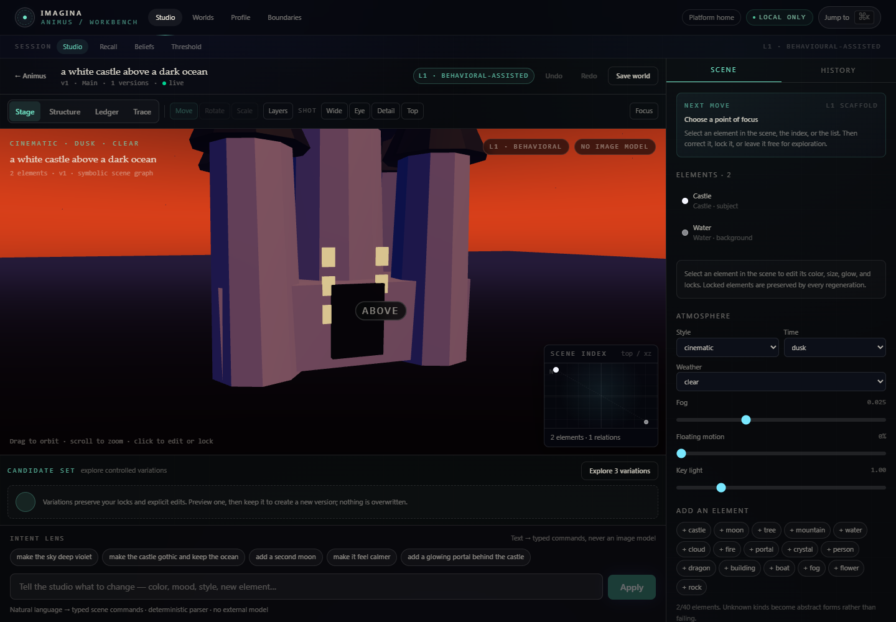

# IMAGINA

**A local-first research platform for imagination, scene authoring, and behavioural measurement.**

IMAGINA asks a difficult question without pretending to answer it by magic: can a person externalize an
imagined scene, inspect it, correct it, and measure the perceptual decisions they make about it — while the
system remains symbolic, auditable, and honest about what it does not know?

The answer is a closed human–AI loop. A person describes an intention, sees a procedural candidate, corrects
what is wrong, locks what is right, and explores controlled variations. The loop — not a one-shot image — is
the product. Around that loop, IMAGINA adds adaptive behavioural tasks that report uncertainty, evidence
counts, and limits instead of a single “imagery score.”



---

## The platform at a glance

| Layer | What it provides | What it deliberately is not |
|---|---|---|
| **ANIMUS Studio** | Intention → symbolic scene → correction → version → regenerate → keep / branch / save world | Not an image generator; not neural reconstruction |
| **Lumen** | Text brief + signal budget → layered first-person world with five local starters | Not diffusion, generated imagery, or mental-content reconstruction |
| **Scene practice** | Deterministic reconstruction and placement tasks with adaptive selection | Not a diagnosis or a measure of imagery strength |
| **Epistemic interview** | Binary probes, Beta posteriors, expected-information-gain selection, uncertainty | Not a read-out of a mental image |
| **Scene Threshold** | 2-AFC contrast discrimination, adaptive staircase, d′, thresholds, calibration | Not a criterion measure, norm, or clinical instrument |
| **Observatory** | Provenance-aware evidence, leave-one-out sensitivity, test–retest reliability | Not a composite score or a latent “imagination ability” |
| **Research platform** | Protocol, benchmark, evidence, validation, and export infrastructure | Not validated neurofeedback or a BCI product |

The public product surface lives at `/animus`. The wider repository also contains the earlier IMAGINA
protocol, benchmark, evidence, and multimodal research stack; all product-facing claims remain gated by the
same scientific boundary.

---

## The ANIMUS loop

```text
intention
   ↓
symbolic scene candidate
   ↓
see it · correct it · lock what is right
   ↓
immutable version + diff
   ↓
controlled regeneration
   ↓
keep · undo · branch · save a world · reopen
```

Every scene is an **ANIMUS-SG-v1** graph: entities, transforms, attributes with provenance and locks,
relations, camera, lighting, atmosphere, dynamics, and constraints. Every mutation is validated and
content-hashed. Every version is immutable. Candidate variation is deterministic and respects locked or
explicitly authored content.

Rendering is procedural React Three Fiber. There is no diffusion model, external renderer, hidden target, or
upload path in the Studio loop. The renderer makes symbolic state visible; it does not invent content behind
the user’s back.

### Why this matters

Most “imagination interfaces” jump straight from a signal to a picture. That framing hides the interesting
part: expression is iterative, correction is informative, and uncertainty is real. IMAGINA makes the
intermediate structure explicit and measurable. A future validated observation source can plug into the same
loop without changing the product contract. In the current release, neural content remains **unauthorized**
and **fail-closed**.

---

## Measurement surfaces

The behavioural instruments are intentionally separate. They do not collapse into one score because they
answer different questions.

### Scene practice and reconstruction

Adaptive scene practice estimates five separate dimensions: object detail, discrimination, spatial structure,
edit control, and confidence calibration. Object reconstruction uses a token bank and F1; spatial layout uses
normalized placement error. Each estimate reports its trial count, uncertainty, and status. The profile also
exposes a descriptive error signature — omissions, intrusions, and mean spatial error — rather than a
diagnosis.

### Epistemic reconstruction interview

After a timed encoding view, the interview asks binary object-presence and spatial-relation probes against a
hidden symbolic scene. Answers and confidence update Beta beliefs; later probes are selected by expected
information gain. The result reports object/spatial accuracy, mean Brier score, coverage, abstention,
overconfidence, and entropy separately. The posterior is a belief over task variables, **not** a neural
image.

### Scene Threshold and observatory

Scene Threshold uses a two-alternative forced-choice contrast task. Two scenes differ only in object
presence, spatial position, or colour. An adaptive 2-down/1-up staircase concentrates trials near the
participant’s threshold; the reported estimate comes from a fitted 75%-correct psychometric function. The
summary separates d′, signed side bias, per-feature thresholds, Brier/overconfidence, type-2 AUC, and
coverage. The observatory overlays ERI evidence provenance, leave-one-out sensitivity, and feature-level
test–retest reliability. Censored thresholds are reported as boundaries, not precise estimates.

---

## Architecture

```text
┌──────────────────────────────────────────────────────────────┐
│  Next.js 16 · React 19 · TypeScript · Tailwind 4 · R3F      │
│  /animus  ·  studio  ·  practice  ·  interview  ·  observatory │
└──────────────────────────────┬───────────────────────────────┘
                               │ typed REST + WebSocket
┌──────────────────────────────▼───────────────────────────────┐
│  FastAPI · Pydantic v2 · per-session serialization           │
│  scene commands · revisions · candidates · measurement        │
└──────────────────────────────┬───────────────────────────────┘
                               │ atomic write bundles
┌──────────────────────────────▼───────────────────────────────┐
│  SQLite (WAL) · event sourcing · migrations through v021     │
│  sessions · versions · branches · worlds · trials · profiles │
└──────────────────────────────────────────────────────────────┘
```

**Core properties**

- **Local-first by default.** SQLite on this machine; no accounts, telemetry, cloud sync, or API keys.
- **Auditable state.** Immutable versions, content hashes, explicit provenance, typed diffs, and durable
  event sequences.
- **Deterministic where it matters.** Intention parsing, scene composition, candidate generation, task
  selection, and scoring are reproducible from stored inputs.
- **Fail-closed claims.** Machine-readable capability envelopes and a claim ceiling gate every label and
  export.
- **Uncertainty is first-class.** Counts, intervals, censoring, coverage, and abstention are part of the
  interface — not footnotes.
- **Authorship is a control surface.** Locks, explicit commands, immutable versions, and branch points stay
  visible; the system proposes candidates but never quietly overwrites the user's decisions.
- **A calibrated mirror, not an oracle.** The interface is designed around inspection and correction, not
  spectacle or a single composite score.

The backend defaults to `127.0.0.1`, validates the `Host` header, and marks Studio responses `no-store`.
Before a non-empty database is upgraded, it writes and integrity-checks a recovery copy under
`<db_dir>/backups/`; if that copy fails, startup aborts rather than migrating without a recovery point.

---

## Quick start

Requirements: Python 3.10+ and a current Node.js installation.

**Terminal 1 — backend**

```powershell
cd backend
python -m pip install -e ".[dev]"
python -m uvicorn app.main:app --host 127.0.0.1 --port 8000
```

**Terminal 2 — frontend**

```powershell
cd frontend
npm install
npm run dev
```

Open **http://localhost:3000/animus**. The backend creates and migrates the local SQLite schema on startup.
API documentation is available at **http://127.0.0.1:8000/docs**.

### Product routes

| Route | Purpose |
|---|---|
| `/animus` | Intention composer, recent sessions, saved worlds |
| `/animus/imagine` | Lumen first-person world lab: presets, composer, signals, adaptive policy, blocked diffusion lane |
| `/animus/studio/[sessionId]` | Scene canvas, prompt bar, candidates, inspector, history |
| `/animus/practice/[sessionId]` | Adaptive scene practice and local scoring |
| `/animus/interview/[sessionId]` | Epistemic interview and posterior reconstruction |
| `/animus/observatory/[sessionId]` | Scene Threshold, confidence atlas, evidence trail, reliability |
| `/animus/profile` | Experimental behavioural estimates, calibration, and limits |
| `/animus/worlds` | Saved world library |
| `/animus/about` | Capability envelope and scientific boundaries |

---

## Verification

The cross-platform entry point is `scripts/verify.py` (wrappers: `verify.sh`, `verify.ps1`):

```bash
python scripts/verify.py --quick   # lint + focused backend tests
python scripts/verify.py --ci      # lint, core/research tests, frontend, claims, compose
python scripts/verify.py --full    # full backend suite + CI profile
```

It reports every check as PASS, FAIL, or SKIP and exits non-zero on failure. In `--ci` mode, a missing
critical tool (npm, Docker) is a failure rather than a skip.

From `frontend/`, the browser-driven check remains available:

```powershell
node scripts/verify-animus-ui.cjs
```

`verify-animus-ui.cjs` drives a real local browser through the authoring loop and fails on console errors. It
writes screenshots to `docs/animus/`.

---

## Scientific boundaries

IMAGINA is a **research prototype**, not a clinical product. The current claim ceiling is
`L1_BEHAVIORAL_ASSISTED`.

- No thought reading, dream decoding, neural content decoding, or neural reconstruction claim.
- No image-generation model or external renderer in the Studio.
- No diagnosis, treatment, clinical validation, or neurofeedback claim.
- No composite “imagination score,” norm, or latent-ability ranking.
- Scene Threshold thresholds are within-scene normalized units; a lower value means finer discrimination,
  not stronger imagery.
- The ERI posterior is a belief over probe variables, not a picture of what someone imagined.
- Aphantasia is treated as a variation and a design constraint, not a deficit.
- Simulations and offline recovery checks are **not** human validation.
- All data stays local; there are no accounts, telemetry, or cloud calls during Studio use.

The full boundary is maintained in [ANIMUS_CLAIMS_BOUNDARY.md](docs/animus/ANIMUS_CLAIMS_BOUNDARY.md), with
the evidence map in [EVIDENCE_MAP.md](docs/animus/EVIDENCE_MAP.md) and the proposed independent study in
[VALIDATION_PROTOCOL.md](docs/animus/VALIDATION_PROTOCOL.md).

---

## Repository map

```text
backend/
  app/core/animus/          symbolic scene graph, loop, Studio service, measurement instruments
  app/api/                  REST and WebSocket surfaces
  app/schemas/              typed wire contracts
  app/storage/migrations/   additive SQLite migrations
  app/tests/                hermetic scene, Studio, measurement, and API tests
  app/evaluation/           offline simulations and recovery checks
frontend/
  app/animus/               product routes
  components/animus/        scene renderer, candidates, probes, atlas, evidence, reliability
  lib/                      typed API client and Studio hooks
docs/
  animus/                   product, architecture, API, measurement, and claims specifications
  ai/                       task briefs, decisions, session log, risks, project context
scripts/                    verification and UI-driving scripts
```

---

## Documentation

| Document | Why read it |
|---|---|
| [ANIMUS product vision](docs/animus/ANIMUS_PRODUCT_VISION.md) | The loop, the north star, and what is real today |
| [Interface principles](docs/animus/INTERFACE_PRINCIPLES.md) | Research synthesis, interaction North Star, and testable next experiments |
| [Lumen world engine](docs/animus/LUMEN_WORLD_ENGINE.md) | World grammar, layered composer, presets, renderer, and staged diffusion path |
| [Architecture](docs/animus/ANIMUS_ARCHITECTURE.md) | Scene graph, Studio service, measurement layers |
| [API contract](docs/animus/API_CONTRACT.md) | Wire formats, concurrency, errors, and WebSocket behavior |
| [Measurement model](docs/animus/MEASUREMENT_MODEL.md) | What the five dimensions mean and do not mean |
| [Reconstruction spec](docs/animus/RECONSTRUCTION_SPEC.md) | Token/F1 and spatial scoring |
| [Adaptive policy](docs/animus/ADAPTIVE_POLICY.md) | Coverage floor, information gain, and difficulty updates |
| [Epistemic interview](docs/animus/EPISTEMIC_INTERVIEW_SPEC.md) | Probes, Beta beliefs, EIG, and abstention |
| [Scene Threshold](docs/animus/CONTRAST_SPEC.md) | 2-AFC design, staircase, and threshold fit |
| [Observatory](docs/animus/OBSERVATORY_SPEC.md) | Provenance, leave-one-out sensitivity, and reliability |
| [Claims boundary](docs/animus/ANIMUS_CLAIMS_BOUNDARY.md) | The exact claim ceiling and forbidden interpretations |
| [Roadmap](docs/animus/ANIMUS_ROADMAP.md) | What comes next and what remains blocked |

---

## License, citation, and contributing

- **Code:** [Apache License 2.0](LICENSE).
- **Documentation and figures:** [CC BY 4.0](LICENSE-DOCS).
- **Citation:** see [CITATION.cff](CITATION.cff). Cite the repository version and the specific study
  artifacts you used; do not cite a demo as validation.
- **Contributing:** read [CONTRIBUTING.md](CONTRIBUTING.md) before opening a pull request.
- **Security:** see [SECURITY.md](SECURITY.md); do not open a public issue for a vulnerability.
- **Governance and claims:** see [GOVERNANCE.md](GOVERNANCE.md). Claim status changes only through a sealed,
  preregistered result, not through consensus or product pressure.

Third-party datasets and instruments retain their own licenses and are not redistributed here.

---

## Status

IMAGINA is an active research prototype. The Studio, measurement surfaces, and observatory are implemented
against an additive schema through migration **v021**; human validation, independent replication, and
neural-content authorization remain future, gated work.

The system is built to make its own limits inspectable. That is the point.
