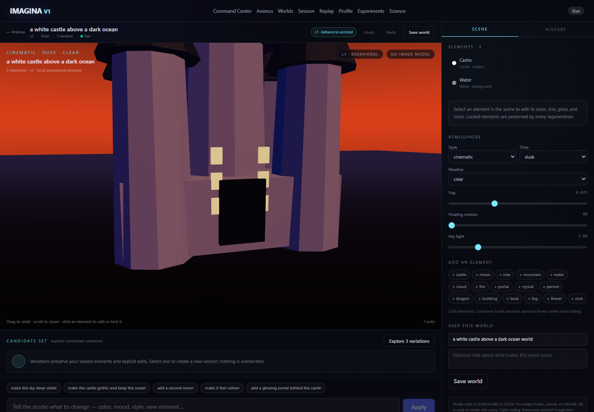

# IMAGINA

**A local-first research platform for imagination, scene authoring, and behavioural measurement.**

`research prototype` · `local-first` · `claim ceiling: L1_BEHAVIORAL_ASSISTED`

IMAGINA asks a difficult question without pretending to answer it by magic:

> Can a person externalize an imagined scene, inspect it, correct it, and measure the perceptual
> decisions they make about it — while the system remains symbolic, auditable, and honest about
> what it does not know?

The answer is a closed human–AI loop. A person describes an intention, sees a procedural candidate,
corrects what is wrong, locks what is right, and explores controlled variations. The loop — not a
one-shot image — is the product. Around that loop, IMAGINA adds adaptive behavioural tasks that
report uncertainty, evidence counts, and limits instead of a single “imagery score.”



---

## Why this repository exists

Most “imagination interfaces” jump straight from a signal to a picture. That framing hides the
interesting part: expression is iterative, correction is informative, and uncertainty is real.

IMAGINA makes the intermediate structure explicit and measurable. It separates three questions that
are often conflated:

1. **What did the person intend?** — a symbolic, editable scene.
2. **What did the person actually report or decide?** — behavioural trials, confidence, source judgments.
3. **What can we legitimately infer?** — a model comparison with uncertainty, not a mind-reading claim.

The platform is built so that its own limits are inspectable. That is the point.

---

## What IMAGINA is — and is not

| IMAGINA is | IMAGINA is not |
|---|---|
| A symbolic scene-authoring and correction loop | Not an image generator or neural reconstruction system |
| A set of separate behavioural measurement surfaces | A single “imagination ability” score |
| A provenance-aware evidence system | A clinical diagnostic or treatment tool |
| A computational research programme with preregistration gates | A validated neurofeedback or BCI product |
| A system that reports uncertainty and abstention | A system that decodes thoughts, dreams, or imagined content |

**The claim ceiling is `L1_BEHAVIORAL_ASSISTED`.** No neural-content, clinical, diagnostic, or
consciousness claim is authorized.

---

## The platform at a glance

| Layer | What it provides | What it deliberately is not |
|---|---|---|
| **ANIMUS Studio** | Intention → symbolic scene → correction → version → regenerate → keep / branch / save world | Not an image generator; not neural reconstruction |
| **Lumen** | Text brief + signal budget → layered first-person world with local starters | Not diffusion, generated imagery, or mental-content reconstruction |
| **Scene practice** | Deterministic reconstruction and placement tasks with adaptive selection | Not a diagnosis or a measure of imagery strength |
| **Epistemic interview** | Binary probes, Beta posteriors, expected-information-gain selection, uncertainty | Not a read-out of a mental image |
| **Scene Threshold** | 2-AFC contrast discrimination, adaptive staircase, d′, thresholds, calibration | Not a criterion measure, norm, or clinical instrument |
| **Observatory** | Provenance-aware evidence, leave-one-out sensitivity, test–retest reliability | Not a composite score or a latent “imagination ability” |
| **Research platform** | Protocol, benchmark, evidence, validation, and export infrastructure | Not validated neurofeedback or a BCI product |

The public product surface lives at `/animus`. The wider repository also contains the earlier
IMAGINA protocol, benchmark, evidence, and multimodal research stack; all product-facing claims
remain gated by the same scientific boundary.

---

## The ANIMUS loop

```text
intention
   ↓
symbolic scene candidate
   ↓
see it · correct it · lock what is right
   ↓
immutable version + diff
   ↓
controlled regeneration
   ↓
keep · undo · branch · save a world · reopen
```

Every scene is an **ANIMUS-SG-v1** graph: entities, transforms, attributes with provenance and
locks, relations, camera, lighting, atmosphere, dynamics, and constraints. Every mutation is
validated and content-hashed. Every version is immutable. Candidate variation is deterministic and
respects locked or explicitly authored content.

Rendering is procedural React Three Fiber. There is no diffusion model, external renderer, hidden
target, or upload path in the Studio loop. The renderer makes symbolic state visible; it does not
invent content behind the user’s back.

---

## Measurement surfaces

The behavioural instruments are intentionally separate. They do not collapse into one score because
they answer different questions.

### Scene practice and reconstruction

Adaptive scene practice estimates five separate dimensions: object detail, discrimination, spatial
structure, edit control, and confidence calibration. Object reconstruction uses a token bank and F1;
spatial layout uses normalized placement error. Each estimate reports its trial count, uncertainty,
and status. The profile also exposes a descriptive error signature — omissions, intrusions, and mean
spatial error — rather than a diagnosis.

### Epistemic reconstruction interview

After a timed encoding view, the interview asks binary object-presence and spatial-relation probes
against a hidden symbolic scene. Answers and confidence update Beta beliefs; later probes are
selected by expected information gain. The result reports object/spatial accuracy, mean Brier score,
coverage, abstention, overconfidence, and entropy separately. The posterior is a belief over task
variables, **not** a neural image.

### Scene Threshold and observatory

Scene Threshold uses a two-alternative forced-choice contrast task. Two scenes differ only in object
presence, spatial position, or colour. An adaptive 2-down/1-up staircase concentrates trials near the
participant’s threshold; the reported estimate comes from a fitted 75%-correct psychometric
function. The summary separates d′, signed side bias, per-feature thresholds, Brier/overconfidence,
type-2 AUC, and coverage. The observatory overlays ERI evidence provenance, leave-one-out
sensitivity, and feature-level test–retest reliability. Censored thresholds are reported as
boundaries, not precise estimates.

---

## The research programme

IMAGINA is not one study. It is a sequence of increasingly expensive questions, each with a gate that
must pass before the next one is allowed to proceed.

| Programme | Question | Current evidence | Status |
|---|---|---|---|
| **C1 — neural–behavioural alignment** | Do neural features add incremental validity for trial-level vividness? | Public EEG dataset `ds005815` (YOTO); classical-feature pipeline produced a null incremental result with a completed falsification battery | `NULL` for the tested pipeline; not a claim that imagery is absent |
| **C2 — neural content and state** | Can content/state be decoded with leakage-safe splits? | Null/limited; no authorized neural-content claim | `NULL` / limited |
| **C3 — fMRI imagery transfer** | Does perception-trained decoding transfer to imagery? | Exploratory, frozen perception decoder; no clinical or mind-reading claim | Exploratory |
| **CRT — Counterfactual Reality Testing** | Which cues explain source judgments: vividness, confidence, context, or a simpler baseline? | Computational design and recovery only; **no human CRT data** | Stage 0I/0J; package `BLOCKED` |

### What CRT is trying to learn

Participants encounter items through different routes — **seen**, **imagined**, **described**, or
**new** — and later make a source judgment. Competing models ask whether those judgments are best
explained by:

- a simple baseline (`M0`);
- prediction consistency (`M2`);
- prediction consistency plus a dual-cost term (`M4`);
- vividness weighting (`M6`);
- confidence-weighted integration (`M7`).

The confirmatory set is `M0`, `M2`, `M4`, `M6`, `M7`; `M1`, `M3`, and `M5` are exploratory. The
outcome is a model comparison with uncertainty — positive, null, or dissociative — not a decoding
accuracy and not a diagnosis.

Stage 0I has produced computational evidence about identifiability, design optimization, SBC,
model recovery, and policy calibration. Those results are **design evidence**, not human evidence.
The registration package remains blocked on inference stability, target-scale full-model checks,
independent review, calibration, and ethics/registration.

Read the details in [CRT Stage 0I protocol](docs/research/CRT_STAGE0I_PROTOCOL.md),
[preregistration](docs/program/CRT_PREREGISTRATION.md), and
[source audit](docs/research/CRT_SOURCE_AUDIT.md).

### Evidence ladder

```text
1. computational specification and simulation     ← CRT is here
2. public-dataset reanalysis                      ← C1, C2, C3
3. preregistered human study                      ← not yet authorized
4. independent replication                        ← not yet attempted
```

A result is never promoted because a demo looks convincing. It is promoted only when the evidence
level and the registered gate both support it.

---

## Architecture

```text
┌──────────────────────────────────────────────────────────────┐
│ Next.js 16 · React 19 · TypeScript · Tailwind 4 · R3F        │
│ /animus · studio · practice · interview · observatory        │
└──────────────────────────────┬───────────────────────────────┘
                               │ typed REST + WebSocket
┌──────────────────────────────▼───────────────────────────────┐
│ FastAPI · Pydantic v2 · per-session serialization            │
│ scene commands · revisions · candidates · measurement        │
└──────────────────────────────┬───────────────────────────────┘
                               │ atomic write bundles
┌──────────────────────────────▼───────────────────────────────┐
│ SQLite (WAL) · event sourcing · additive migrations          │
│ sessions · versions · branches · worlds · trials · profiles  │
└──────────────────────────────────────────────────────────────┘

Research layer
  analysis/crt/          hierarchical models · SBC · design optimization · M7 diagnosis
  science/registry/      artifacts · gates · claims
  science/protocols/     CRT · ART · PRM protocol definitions
  results/               canonical JSON artifacts and ledger
```

**Core properties**

- **Local-first by default.** SQLite on this machine; no accounts, telemetry, cloud sync, or API keys.
- **Auditable state.** Immutable versions, content hashes, explicit provenance, typed diffs, and durable
  event sequences.
- **Deterministic where it matters.** Intention parsing, scene composition, candidate generation, task
  selection, and scoring are reproducible from stored inputs.
- **Fail-closed claims.** Machine-readable capability envelopes and a claim ceiling gate every label and
  export.
- **Uncertainty is first-class.** Counts, intervals, censoring, coverage, and abstention are part of the
  interface — not footnotes.
- **Authorship is a control surface.** Locks, explicit commands, immutable versions, and branch points stay
  visible; the system proposes candidates but never quietly overwrites the user’s decisions.

The backend defaults to `127.0.0.1`, validates the `Host` header, and marks Studio responses
`no-store`. Before a non-empty database is upgraded, it writes and integrity-checks a recovery copy
under `<db_dir>/backups/`; if that copy fails, startup aborts rather than migrating without a recovery
point.

---

## Quick start

Requirements: Python 3.10+ and a current Node.js installation.

**Terminal 1 — backend**

```powershell
cd backend
python -m pip install -e ".[dev,crt]"
python -m uvicorn app.main:app --host 127.0.0.1 --port 8000
```

**Terminal 2 — frontend**

```powershell
cd frontend
npm install
npm run dev
```

Open **http://localhost:3000/animus**. The backend creates and migrates the local SQLite schema on
startup. API documentation is available at **http://127.0.0.1:8000/docs**.

### Product routes

| Route | Purpose |
|---|---|
| `/animus` | Intention composer, recent sessions, saved worlds |
| `/animus/imagine` | Lumen first-person world lab: presets, composer, signals, adaptive policy, blocked diffusion lane |
| `/animus/studio/[sessionId]` | Scene canvas, prompt bar, candidates, inspector, history |
| `/animus/practice/[sessionId]` | Adaptive scene practice and local scoring |
| `/animus/interview/[sessionId]` | Epistemic interview and posterior reconstruction |
| `/animus/observatory/[sessionId]` | Scene Threshold, confidence atlas, evidence trail, reliability |
| `/animus/profile` | Experimental behavioural estimates, calibration, and limits |
| `/animus/worlds` | Saved world library |
| `/animus/about` | Capability envelope and scientific boundaries |

### Research-only checks

The CRT modules are importable from the repository root; run them from `backend/` so the backend
package is on the path:

```powershell
cd backend
$env:PYTHONPATH="..;$PWD"
python -m pytest app/tests/test_crt_stage0i.py app/tests/test_crt_m7_diagnostic.py -q
python -m app.cli.science_ledger --check
```

The CRT NumPyro extras are optional. They are intended for a separate environment or a GPU host:

```powershell
python -m pip install -e ".[crt]"
```

---

## Verification

The cross-platform entry point is `scripts/verify.py` (wrappers: `verify.sh`, `verify.ps1`):

```bash
python scripts/verify.py --quick   # lint + focused backend tests
python scripts/verify.py --ci      # lint, core/research tests, frontend, claims, compose
python scripts/verify.py --full    # full backend suite + CI profile
```

It reports every check as PASS, FAIL, or SKIP and exits non-zero on failure. In `--ci` mode, a missing
critical tool (npm, Docker) is a failure rather than a skip.

From `frontend/`, the browser-driven check remains available:

```powershell
node scripts/verify-animus-ui.cjs
```

`verify-animus-ui.cjs` drives a real local browser through the authoring loop and fails on console
errors. It writes screenshots to `docs/animus/`.

---

## Scientific boundaries

IMAGINA is a **research prototype**, not a clinical product. The current claim ceiling is
`L1_BEHAVIORAL_ASSISTED`.

- No thought reading, dream decoding, neural content decoding, or neural reconstruction claim.
- No image-generation model or external renderer in the Studio.
- No diagnosis, treatment, clinical validation, or neurofeedback claim.
- No composite “imagination score,” norm, or latent-ability ranking.
- Scene Threshold thresholds are within-scene normalized units; a lower value means finer discrimination,
  not stronger imagery.
- The ERI posterior is a belief over probe variables, not a picture of what someone imagined.
- Aphantasia is treated as a variation and a design constraint, not a deficit.
- Simulations and offline recovery checks are **not** human validation.
- Public datasets are not a substitute for a preregistered CRT study.
- All data stays local; there are no accounts, telemetry, or cloud calls during Studio use.

The full boundary is maintained in [ANIMUS_CLAIMS_BOUNDARY.md](docs/animus/ANIMUS_CLAIMS_BOUNDARY.md),
with the evidence map in [EVIDENCE_MAP.md](docs/animus/EVIDENCE_MAP.md) and the proposed independent
study in [VALIDATION_PROTOCOL.md](docs/animus/VALIDATION_PROTOCOL.md).

---

## Repository map

```text
backend/
  app/core/animus/          symbolic scene graph, loop, Studio service, measurement instruments
  app/api/                  REST and WebSocket surfaces
  app/schemas/              typed wire contracts
  app/storage/migrations/   additive SQLite migrations
  app/tests/                hermetic scene, Studio, measurement, and research tests
  app/evaluation/           offline simulations and recovery checks
analysis/
  crt/                      hierarchical CRT models, SBC, design optimization, policy model
frontend/
  app/animus/               product routes
  components/animus/        scene renderer, candidates, probes, atlas, evidence, reliability
  lib/                      typed API client and Studio hooks
science/
  registry/                 artifacts, gates, and claims
  protocols/                CRT, ART, and PRM protocol definitions
results/
  crt/                      canonical CRT simulation and readiness artifacts
docs/
  animus/                   product, architecture, API, measurement, and claims specifications
  program/                  preregistration, analysis plans, and registered-report packages
  research/                 theory audits, source audits, and literature positioning
  ai/                       task briefs, decisions, session log, risks, project context
scripts/                    verification and UI-driving scripts
```

---

## Documentation

### Product and measurement

| Document | Why read it |
|---|---|
| [ANIMUS product vision](docs/animus/ANIMUS_PRODUCT_VISION.md) | The loop, the north star, and what is real today |
| [Interface principles](docs/animus/INTERFACE_PRINCIPLES.md) | Research synthesis, interaction North Star, and testable next experiments |
| [Lumen world engine](docs/animus/LUMEN_WORLD_ENGINE.md) | World grammar, layered composer, presets, renderer, and staged diffusion path |
| [Architecture](docs/animus/ANIMUS_ARCHITECTURE.md) | Scene graph, Studio service, measurement layers |
| [API contract](docs/animus/API_CONTRACT.md) | Wire formats, concurrency, errors, and WebSocket behavior |
| [Measurement model](docs/animus/MEASUREMENT_MODEL.md) | What the five dimensions mean and do not mean |
| [Reconstruction spec](docs/animus/RECONSTRUCTION_SPEC.md) | Token/F1 and spatial scoring |
| [Adaptive policy](docs/animus/ADAPTIVE_POLICY.md) | Coverage floor, information gain, and difficulty updates |
| [Epistemic interview](docs/animus/EPISTEMIC_INTERVIEW_SPEC.md) | Probes, Beta beliefs, EIG, and abstention |
| [Scene Threshold](docs/animus/CONTRAST_SPEC.md) | 2-AFC design, staircase, and threshold fit |
| [Observatory](docs/animus/OBSERVATORY_SPEC.md) | Provenance, leave-one-out sensitivity, and reliability |
| [Claims boundary](docs/animus/ANIMUS_CLAIMS_BOUNDARY.md) | The exact claim ceiling and forbidden interpretations |
| [Roadmap](docs/animus/ANIMUS_ROADMAP.md) | What comes next and what remains blocked |

### Research programme

| Document | Why read it |
|---|---|
| [Program status](docs/program/PROGRAM_STATUS.md) | Canonical gate and claim status, generated from the registry |
| [CRT Stage 0I protocol](docs/research/CRT_STAGE0I_PROTOCOL.md) | Identifiability, target-scale design, SBC, and readiness blockers |
| [CRT Stage 0J protocol](docs/research/CRT_STAGE0J_PROTOCOL.md) | Target-scale NUTS SBC/recovery, compute rules, and failure modes |
| [CRT preregistration](docs/program/CRT_PREREGISTRATION.md) | Hypotheses, endpoints, stopping rules, and claim ceiling |
| [CRT analysis plan](docs/program/CRT_ANALYSIS_PLAN.md) | Model space, estimands, and analysis sequence |
| [CRT source audit](docs/research/CRT_SOURCE_AUDIT.md) | Primary-source verification and corrections |
| [CRT adversarial collaboration](docs/program/CRT_ADVERSARIAL_COLLABORATION.md) | Pre-specified disagreement and adjudication procedure |
| [CRT theory adjudication](docs/program/CRT_THEORY_ADJUDICATION.md) | Competing theoretical accounts and discriminating predictions |
| [Systematic review workspace](docs/research/review/README.md) | Protocol and templates; not yet a systematic review |
| [Ethics package](docs/program/CRT_ETHICS_PACKAGE.md) | Template; no approval exists |
| [Stage 1 checklist](docs/program/CRT_STAGE1_REGISTRATION_CHECKLIST.md) | Registration blockers and sign-off |

### Paper and business

| Document | Why read it |
|---|---|
| [Paper workspace](paper/README.md) | Methods paper and Registered Report plan; no submission |
| [Business workspace](business/README.md) | Pre-traction positioning, pilots, and funding hypotheses |
| [Claims guardrails](business/CLAIMS_GUARDRAILS.md) | How public business and paper text is reviewed |

### Operations

| Document | Why read it |
|---|---|
| [Release checklist](docs/operations/RELEASE_CHECKLIST.md) | Release gates and known automation gaps |
| [Threat model](docs/operations/THREAT_MODEL.md) | Local-first deployment risks and controls |
| [Accessibility status](docs/operations/ACCESSIBILITY.md) | What is verified and what is not |

---

## License, citation, and contributing

- **Code:** [Apache License 2.0](LICENSE).
- **Documentation and figures:** [CC BY 4.0](LICENSE-DOCS).
- **Citation:** see [CITATION.cff](CITATION.cff). Cite the repository version and the specific study
  artifacts you used; do not cite a demo as validation.
- **Authors and roles:** see [AUTHORS.md](AUTHORS.md); the PI and independent statistician are not yet
  assigned, which blocks the human study.
- **Contributing:** read [CONTRIBUTING.md](CONTRIBUTING.md) before opening a pull request.
- **Security:** see [SECURITY.md](SECURITY.md); do not open a public issue for a vulnerability.
- **Governance and claims:** see [GOVERNANCE.md](GOVERNANCE.md). Claim status changes only through a
  sealed, preregistered result, not through consensus or product pressure.

Third-party datasets and instruments retain their own licenses and are not redistributed here.

---

## Status

IMAGINA is an active research prototype. The Studio, measurement surfaces, and observatory are
implemented against an additive schema through migration **v021**. The CRT programme has completed
computational Stage 0I design work, but its registration package is **BLOCKED**: inference is not yet
stable at target scale, independent review has not occurred, calibration has not been run, and no
ethics approval or registration exists.

Stage 0J target-scale readiness is also **BLOCKED** while the publication-grade NumPyro/JAX backend is
unavailable. The paper and business workspaces are drafts, not submissions or commitments.

Human CRT data collection is **not authorized**. Public datasets, simulations, and model-recovery
checks are not substitutes for a preregistered human study.

The system is built to make its own limits inspectable. That is the point.
