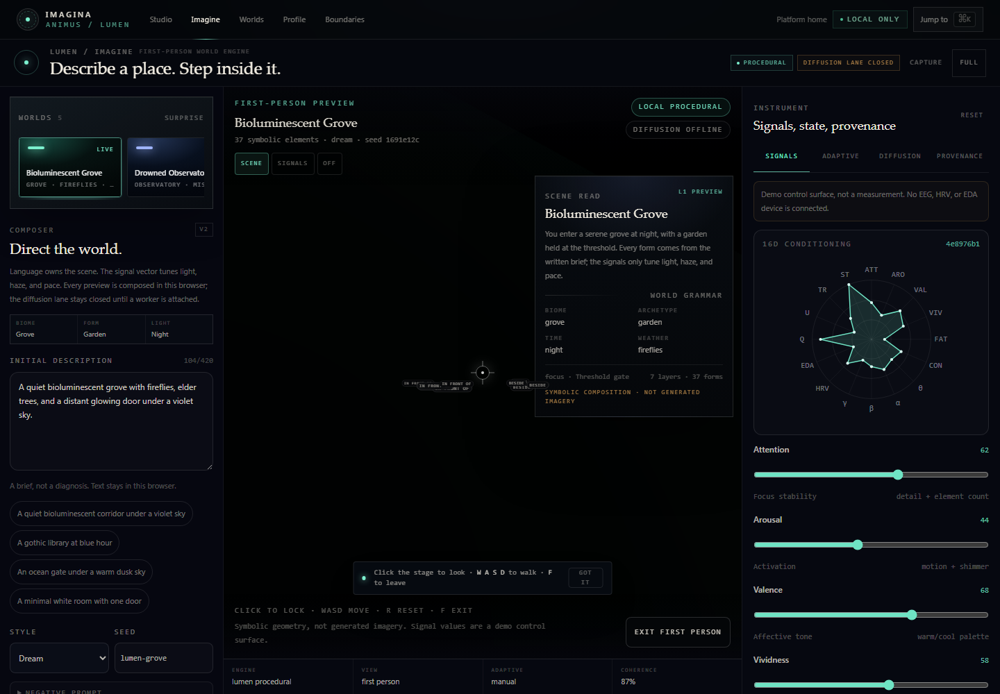

# Lumen world engine

Status: **local procedural preview; diffusion lane blocked until a remote A100 worker exists**.
Route: `/animus/imagine`. Claim ceiling: `L1_BEHAVIORAL_ASSISTED`.

Lumen is the scene-composition layer behind the Imagine lab. It turns a written brief and a derived signal vector into
a layered, walkable `SceneGraph`. It does not run a diffusion model, does not reconstruct imagery, and does not send
neural, physiological, or participant data anywhere.

*Actual local render at 1440×1000, captured from `/animus/imagine?preset=grove`. Procedural geometry and shaders only.*

## Why a world grammar

The first Imagine demo scattered primitives around a corridor. It proved the first-person loop, but it did not support
the decisions a scene-generation interface has to make: what is near, what is far, what frames the view, what the
person can walk through, and which parts of the image came from the text rather than from a control signal.

Lumen separates those decisions:

- **Text owns semantics.** Prompt terms select biome, archetype, focal object, time, weather, palette hints, and named
  props.
- **Signals own the perceptual budget.** Attention widens/narrows the path and detail; arousal adds motion; valence
  shifts the horizon; vividness adds emissive light; fatigue adds fog; confidence sets attribute confidence. Signals
  never choose people, objects, or meaning.
- **Every form has provenance.** Each entity carries `semantic_source`, `layer`, `collidable`, `anchor`, and `variant`.
  The scene metadata stores the full `WorldSpec`, prompt, signal vector, claim ceiling, and warnings.

## WorldSpec

`frontend/lib/imagine/world.ts` derives a deterministic specification:

| Field | Values / meaning |
| --- | --- |
| Biome | `grove`, `coast`, `interior`, `ruin`, `observatory`, `void` |
| Archetype | `threshold`, `colonnade`, `bridge`, `library`, `garden`, `shrine`, `observatory`, `citadel` |
| Time | `dawn`, `day`, `dusk`, `night` |
| Weather | `clear`, `mist`, `rain`, `snow`, `embers`, `fireflies` |
| Mood | `calm`, `awe`, `melancholy`, `tension`, `wonder` |
| Focal | gate, shelves, bridge, moon, tree, tower, water, altar, dome, crystal, column |
| Layers | `spawn`, `approach`, `threshold`, `flank`, `midground`, `horizon`, `detail` |
| Path | start, end, width |
| Camera | spawn, target, FOV, eye height |

The same prompt, style, seed, and signal vector produce the same world. Changing the seed produces a different local
composition without changing the semantics of the brief.

## Composition

`frontend/lib/imagine/composeWorld.ts` composes in passes:

1. focal object beyond the walkable end;
2. central approach path (non-collidable);
3. architecture grammar (shelf walls, piers, colonnades, observatory piers, bridge, garden trees, citadel towers);
4. biome props (water, ground cover, void crystals);
5. prompt-named props not already implied by the archetype;
6. generic path lanterns and stones;
7. ground detail and atmosphere motes;
8. horizon silhouettes and a sun/moon.

The result is capped at 40 entities. The cap protects draw calls and collision predictability; metadata records whether
detail was truncated. Collidable entities are kept outside the walkable path corridor.

## Renderer

`frontend/components/animus/world/` adds:

- a sky shader with vertical gradient, sun/moon disk, atmospheric halo, and optional aurora;
- a terrain shader that draws a lighter approach path with a thin emissive edge;
- practical point lights from the nearest lantern/portal/shrine/crystal entities (max three);
- ambient motes;
- architecture bodies for library, table, lantern, column, colonnade, ring, observatory, monolith, mote, firefly,
  path, and shrine;
- an `UnrealBloomPass` composer built from the `three` examples already in the dependency tree.

The composer is skipped under `prefers-reduced-motion`, and the existing orbit/Studio renderer is unchanged for scenes
without `metadata.world`.

## Presets and URL

`frontend/lib/imagine/presets.ts` ships five starters:

| Id | World |
| --- | --- |
| `grove` | Bioluminescent Grove |
| `observatory` | Drowned Observatory |
| `library` | Gothic Library |
| `coast` | Salt Coast |
| `void` | Void Garden |

`/animus/imagine?preset=grove` loads a starter. Unknown ids leave the current world unchanged and show a notice.
Presets are presentation state, not saved Studio worlds.

## Interface rationale

The interface follows the Lumen Atelier direction: near-black ink, warm bone text, mint signal, amber lock, iris
accent, hairline trays, serif display, and mono instrumentation. The stage remains the largest surface. A world strip
makes composition visible before the prompt field; a scene-read overlay states biome, archetype, time, weather, focal
object, layer count, and the explicit boundary; the stage lens switches between scene, signals, and off.

This is an interaction hypothesis. No usability, preference, spatial-memory, or imagery-outcome study has been run.

## Diffusion path (not implemented)

The final target is a diffusion-backed world, not a larger primitive scatter. The honest staged path is:

| Stage | Generated output | Still local | Gate |
| --- | --- | --- | --- |
| 0 (now) | none | all geometry, collision, camera, UI | none |
| 1 | 4096×2048 equirectangular skybox, 1280×720 preview | geometry, collision, navigation | A100 worker + consent + manifest validation |
| 2 | skybox plus depth/matte layers conditioned on the Lumen layout | collision proxies and walkable path | multi-view consistency checks |
| 3 | multi-view or splat reconstruction fitted to the Lumen layout | collision, semantics, provenance | independent evaluation |

Conditioning for stage 1 is text plus the eight aesthetic controls and the 16D vector. Raw neural or physiological
series must not leave the machine. Stage 2 may use a rendered depth/layout scaffold from the local composer as a
structural condition; that is a scene prior, not a readout of a person's imagery.

Evaluation must report composition preference, spatial coherence, and layout adherence separately. A generated skybox
or matte is an aesthetic environment texture, never a measurement, reconstruction, diagnosis, or evidence that the
system knows what a person imagined.

## Verification contract

- `tsc --noEmit` and ESLint on changed frontend files.
- `vitest run` includes world grammar and composer tests: determinism, path clearance, layer coverage, semantic
  provenance, preset validity, and signal/semantic separation.
- Targeted Playwright covers the offline diffusion lane, consent flow, first-person toggle, preset URL, responsive
  overflow, and console errors.
- Bundle budget must stay under the non-3D route ceiling after the post-processing import.

## Limits

- No diffusion weights, text encoder, A100, or generated image exists in this repository.
- The world is a procedural interpretation of a brief, not a reconstruction of mental content.
- The signal vector is a demo control surface unless a future provider supplies measured features.
- No clinical, diagnostic, or efficacy claim is supported.
- Preset quality is a design judgement, not an empirically validated preference result.
